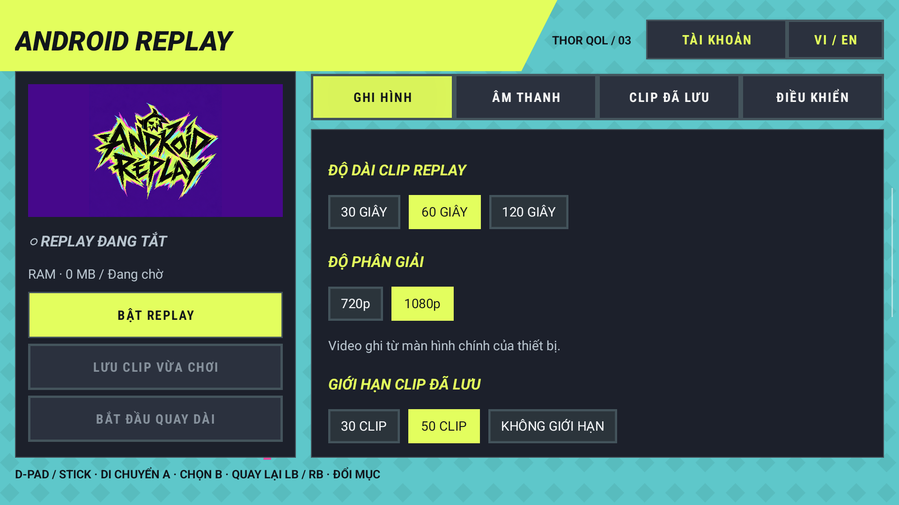
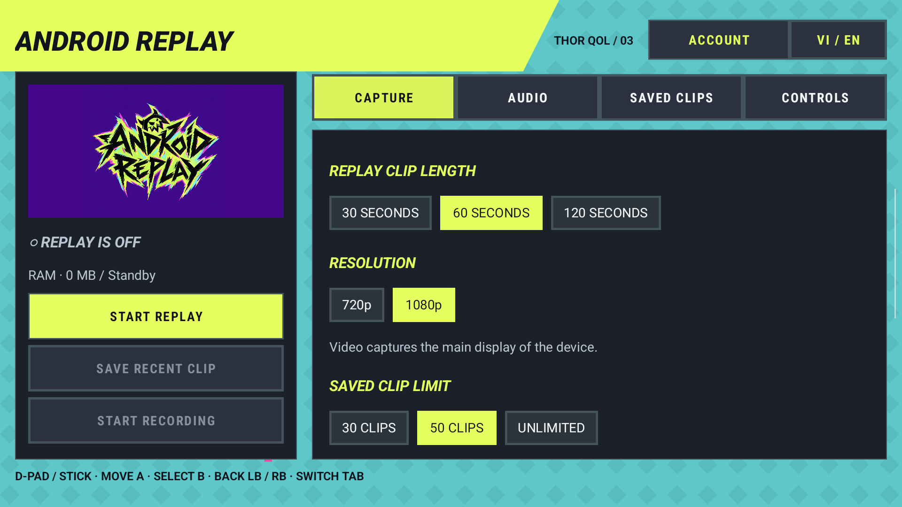

# Android Replay 2.7.0

Android Replay lưu khoảnh khắc vừa chơi và quay video trên Android. Đây là tên hiển thị mới của Thor Instant Replay; package `com.thor.instantreplay`, dữ liệu và các action tích hợp cũ được giữ nguyên.





## Chức năng

- Ghi video màn hình chính vào bộ đệm RAM, lưu lại 30 / 60 / 120 giây vừa qua thành MP4.
- Bắt đầu / dừng quay video dài và lưu vào `Movies/ThorClips`.
- Chọn 720p hoặc 1080p; mã hóa video bằng phần cứng, cấu hình mục tiêu 60 FPS.
- Trộn âm thanh game với micro, chỉnh âm lượng riêng và bật lọc ồn micro.
- Lưu clip bằng giữ HOME 3 giây, L3 + R3 hoặc nút nổi CLIP khi đã bật dịch vụ Hỗ trợ tiếp cận.
- Xem clip gần đây và chia sẻ qua mã QR / địa chỉ Wi-Fi để thiết bị cùng mạng xem, tải clip.
- Giới hạn lưu 30 / 50 clip hoặc không giới hạn; tự xóa clip cũ nhất khi vượt mức đã chọn.
- Giao diện ngang điều khiển bằng D-pad / cần trái; A kích hoạt khi nhả, LB / RB đổi mục. Tiếng Việt và English có thể chọn trong app.

Video được ghi từ màn hình chính. Ghép hai màn hình chưa được triển khai trong nguồn hiện tại, vì vậy bản này không hiển thị lựa chọn ghép màn hình. Android yêu cầu quyền ghi hình / ghi âm; một số ứng dụng có thể chặn thu âm thanh nội bộ. Hiệu năng thực tế phụ thuộc thiết bị và game.

## English

- Save the previous 30 / 60 / 120 seconds of main-display video from a RAM replay buffer to MP4.
- Start / stop continuous recording to `Movies/ThorClips`.
- Choose 720p or 1080p, hardware video encoding with a target of 60 FPS.
- Mix game and microphone audio; adjust their levels separately and enable microphone noise filtering.
- Save using a 3-second HOME hold, L3 + R3, or the floating CLIP button with the accessibility service enabled.
- Browse recent clips and share them over local Wi-Fi using a QR code / address.
- Keep 30 / 50 clips or choose unlimited; the oldest clips are deleted automatically when the selected limit is exceeded.
- Landscape UI with D-pad / left-stick controls and Vietnamese / English selection.

Main-display capture only; dual-screen stitching is not implemented in the current encoder. Some apps block internal audio capture.

## Build

JDK 17, Android SDK 35, Gradle 9.4.1 and AGP 9.2.1. AGP provides built-in Kotlin compilation. Do not add a second Kotlin Android plugin.

```powershell
. E:\Codex\Viet-Hoa-PC\environment.ps1
$env:GRADLE_USER_HOME='E:\DevTools\Gradle\UserHome'
$env:ANDROID_USER_HOME='E:\DevTools\Android\UserHome'
$env:KHOGAME_DEBUG_KEYSTORE='E:\DevTools\Android\UserHome\debug.keystore'
.\gradlew.bat --no-daemon :app:assembleRelease :app:assembleDebugAndroidTest
```

The release uses the existing signing identity so it can update the installed app without deleting data. Signing keys are external to the repository and must not be published. APK: `app/build/outputs/apk/release/app-release.apk`.

LAN sharing accepts only direct MP4 files inside the canonical clip directory. Generated web links preserve Unicode / spaces / plus characters; path traversal and encoded path separators are rejected. Host file-policy and actual HTTP regression harnesses are in `tests/standalone` and `tests/host-server`. The device QA runner also accepts `-e mode clipBoundary` to exercise the same boundary policy, including a symlink escape, against owned temporary cache files.

`AppLanguage.get(context)` / `set(context,"vi"|"en")` / `wrap(context)` are available to Java and Kotlin. The language is kept in `android_replay_ui.language`, and setting it also synchronizes `thorqol_ui.language` for the combo account screen. Existing capture preferences remain in `thor_replay_prefs`.

Mục Tài khoản đã tích hợp giao diện dùng chung cho combo. Cấu hình hiện tại là preview: chưa kết nối máy chủ / xác nhận thanh toán và chưa bật khóa trả phí. Không có đường đăng nhập giả hoặc tự xác nhận đã mua. The original source did not include an online APK updater; the update channel still needs a separate implementation before distribution through in-app updates.

## License

[Apache License 2.0](LICENSE). The original package, service action names, preference file and `Movies/ThorClips` directory are retained for upgrade compatibility.
