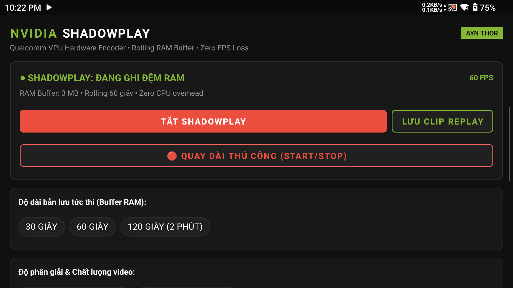
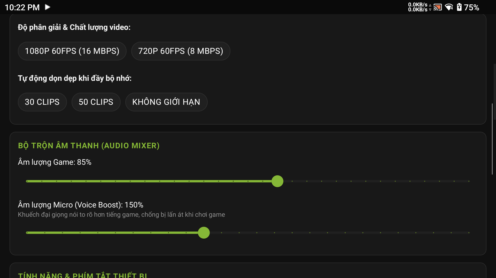

# Thor Instant Replay (AYN Thor Edition - NVIDIA Theme)

<p align="center">
  
  
</p>

<p align="center">
  
  
  
  
  
  
</p>

Ứng dụng quay màn hình Rolling RAM Buffer phong cách **NVIDIA GeForce ShadowPlay** tối ưu riêng cho máy chơi game cầm tay **AYN Thor** (2 màn hình, Snapdragon 8 Gen 2 / 865, Android 13).

---

## 🌟 Tính Năng Nổi Bật (Key Features - v2.6 NVIDIA Edition)

### 1. Bộ Đệm Vòng RAM Xoay Vòng (Instant Replay Rolling Buffer)
- Hoạt động như **NVIDIA GeForce ShadowPlay** trên PC: Luôn ghi hình vào bộ đệm RAM xoay vòng (tùy chỉnh từ 30s đến 300s).
- Khi có pha highlight hay khoảnh khắc xuất thần trong game, chỉ cần bấm **Lưu Clip** hoặc giữ phím cứng để trích xuất video về máy ngay lập tức mà không cần quay liên tục gây tốn dung lượng bộ nhớ.

### 2. Bộ Trộn Âm Thanh & Khuếch Đại Giọng Nói (Audio Mixer & Voice Boost)
- **Voice Boost (0% - 300%)**: Tăng âm lượng Micro thu âm trên máy cầm tay (vốn cách xa miệng 30-40cm) giúp giọng bình luận to, rõ ràng và ấm áp.
- **Game Volume (0% - 150%)**: Tùy chỉnh cân đối âm lượng nội bộ của game.
- **Thuật toán Soft-Limiter Saturation**: Tự động nén âm dải động (Dynamic Range Compression) chống hiện tượng vỡ tiếng (audio clipping/distortion) khi reo hò hoặc khi game có âm thanh cháy nổ lớn.

### 3. Chế Độ Quay Dài Thủ Công (Manual Continuous Recording)
- Thêm nút chuyển đổi **🔴 BẮT ĐẦU QUAY DÀI** / **⏹ DỪNG QUAY THỦ CÔNG**.
- **Cơ chế ghi trực tiếp (Direct-to-Disk Muxing)**: Stream từng frame video H.264/H.265 trực tiếp xuống bộ nhớ flash (`/sdcard/Movies/ThorClips/Record_*.mp4`), **hoàn toàn không tốn thêm 1 MB RAM nào** của bộ đệm vòng. Bạn có thể quay video game dài 1 tiếng, 2 tiếng tùy ý.

### 4. Âm Báo "Ting" Pha Lê (Crystal Bell Chime)
- Khi bấm lưu clip Instant Replay hoặc dừng quay dài, máy phát ra một âm báo "Ting" pha lê (hòa âm nốt E6 + E7 phai dần) phong cách Nintendo Switch / NVIDIA ShadowPlay.
- Giúp người chơi nhận biết clip đã được ghi thành công vào máy mà không cần rời mắt khỏi trận đấu.
- Tổng hợp trực tiếp qua `AudioTrack` với độ trễ 0ms, không cần file nhạc ngoài và không ngắt âm thanh game.

### 5. Hỗ Trợ 2 Màn Hình Ghép (Dual-Screen Top & Bottom Stitching)
- Nhận diện trực tiếp 2 màn hình vật lý của AYN Thor:
  - Màn hình chính (Top Display 0): 1080p
  - Màn hình phụ (Bottom Display 4): 1080x1240
- Tùy chọn xuất video ghép liền mạch (Vertical Stitch 1080 x 2320) hoặc chỉ quay màn hình chính.

### 6. Phím Tắt Phần Cứng Tiện Lợi (Hardware HOME Trigger)
- Đè phím cứng **HOME** trong 5 giây để kích hoạt lưu clip tức thì kèm 2 nhịp rung phản hồi Haptic.
- Nhả phím trước 5 giây: Giữ nguyên tính năng tráo 2 màn hình (Display Swap sau 0.5s) của ứng dụng **Thor Wayfinder** mà không hề xung đột.

### 7. Tối Ưu Hóa Pin & Chế Độ Ngủ Sâu (Doze Mode / Deep Sleep Optimization)
- Tự động dừng (`stop`) và giải phóng hoàn toàn (`release`) luồng `AudioRecord` khi màn hình tắt (`Screen OFF`), triệt tiêu hoàn toàn wakelock `AudioIn`.
- Khi bật màn hình lại (`Screen ON`), luồng audio tự động hồi sinh mượt mà. Đảm bảo máy vào Deep Sleep tiết kiệm 100% pin khi gập máy / tắt màn hình.

### 8. Chia Sẻ Clip Siêu Tốc Qua Wi-Fi Nội Bộ (Local Web Server & QR Code)
- Tích hợp sẵn máy chủ HTTP mini (Port 8080).
- Hiển thị mã QR trực tiếp trên màn hình phụ. Quét QR bằng điện thoại hoặc gõ IP trên PC để duyệt và tải clip tốc độ cao qua mạng LAN.

---

## 🛠️ Yêu Cầu Cấp Quyền Qua ADB (One-Time Setup)

Do Android giới hạn việc quay màn hình ngầm và bắt âm thanh nội bộ, bạn cần cấp các quyền sau qua lệnh ADB một lần duy nhất:

```bash
# Cấp quyền ghi âm nội bộ
adb shell pm grant com.thor.instantreplay android.permission.RECORD_AUDIO

# Cấp quyền chụp màn hình ngầm
adb shell appops set com.thor.instantreplay PROJECT_MEDIA allow

# Cấp quyền vẽ cửa sổ nổi HUD
adb shell appops set com.thor.instantreplay SYSTEM_ALERT_WINDOW allow

# Bỏ qua tối ưu hóa pin (tránh bị hệ thống kill ngầm)
adb shell dumpsys deviceidle whitelist +com.thor.instantreplay

# Bật dịch vụ Accessibility để bắt sự kiện giữ phím HOME 5s:
adb shell settings put secure enabled_accessibility_services com.thor.instantreplay/.service.ThorKeyTriggerService:com.thorwayfinder.app/.ForegroundAppService
adb shell settings put secure accessibility_enabled 1
```

---

## 🏗️ Hướng Dẫn Biên Dịch (Build from Source)

### Yêu cầu:
- JDK 17
- Android SDK (API 35, Build Tools 35.0.0)

### Lệnh build:
```bash
# Clone repository
git clone https://github.com/dodangquang/thor-instant-replay.git
cd thor-instant-replay

# Biên dịch Debug APK
./gradlew assembleDebug

# Biên dịch Release APK
./gradlew assembleRelease
```
File APK sau khi build sẽ nằm tại: `app/build/outputs/apk/release/app-release-unsigned.apk` hoặc `app/build/outputs/apk/debug/app-debug.apk`.

---

## 📁 Cấu Trúc Mã Nguồn

```
thor-instant-replay/
├── app/
│   ├── build.gradle.kts
│   ├── proguard-rules.pro
│   └── src/main/
│       ├── AndroidManifest.xml
│       ├── java/com/thor/instantreplay/
│       │   ├── MainActivity.kt               # Giao diện điều khiển NVIDIA HUD & Audio Mixer
│       │   ├── TransparentPermissionActivity.kt # Activity trong suốt xin quyền MediaProjection
│       │   ├── buffer/CircularMediaBuffer.kt # Bộ đệm RAM xoay vòng & ghi đĩa trực tiếp
│       │   ├── encoder/
│       │   │   ├── ScreenEncoder.kt          # Bộ mã hóa Qualcomm VPU Hardware Acceleration
│       │   │   ├── AudioEncoder.kt           # Bộ thu & trộn âm thanh Game + Micro
│       │   │   ├── OpenSourceNoiseFilter.kt  # Bộ lọc nhiễu & Soft-Limiter chống vỡ tiếng
│       │   │   └── DualScreenHelper.kt       # Tính toán tỷ lệ ghép 2 màn hình
│       │   ├── service/
│       │   │   ├── ReplayService.kt          # Foreground Service quản lý chu kỳ sống
│       │   │   ├── ThorKeyTriggerService.kt  # Bắt phím cứng HOME 5 giây & Haptic feedback
│       │   │   ├── SaveClipReceiver.kt       # BroadcastReceiver nhận lệnh lưu clip
│       │   │   └── BootReceiver.kt           # Tự kích hoạt lại dịch vụ khi khởi động máy
│       │   ├── share/
│       │   │   ├── ThorWebServer.kt          # Web server HTTP nội bộ chia sẻ clip
│       │   │   └── QrCodeHelper.kt           # Tạo mã QR kết nối nhanh
│       │   └── util/
│       │       └── AudioChimeHelper.kt       # Tổng hợp âm báo "Ting" pha lê E6/E7
│       └── res/
│           ├── layout/activity_main.xml      # Layout Dark Gaming NVIDIA Neon
│           └── values/                       # Colors, Strings, Themes
├── docs/screenshots/                         # Hình ảnh giao diện thực tế
├── build.gradle.kts
├── settings.gradle.kts
└── README.md
```

---

## 📄 License
Phát hành theo giấy phép [Apache License 2.0](LICENSE).
Tương thích hoàn hảo với thiết bị AYN Thor và hệ sinh thái Thor Wayfinder.
