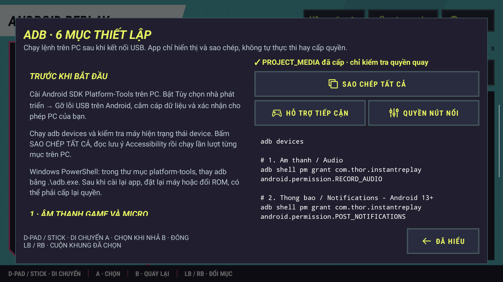

# Android Replay 2.9.0

Android Replay lưu khoảnh khắc vừa chơi và quay video trên Android. Đây là tên hiển thị mới của Thor Instant Replay; package `com.thor.instantreplay`, dữ liệu và các action tích hợp cũ được giữ nguyên.


## Chức năng

- Ghi video màn hình chính vào bộ đệm RAM, lưu lại 30 / 60 / 120 giây vừa qua thành MP4.
- Bắt đầu / dừng quay video dài và lưu vào `Movies/ThorClips`.
- Chọn 720p hoặc 1080p; mã hóa video bằng phần cứng, cấu hình mục tiêu 60 FPS.
- Trộn âm thanh game với micro, chỉnh âm lượng riêng và bật lọc ồn micro.
- Lưu clip bằng giữ HOME 3 giây, L3 + R3 hoặc nút nổi CLIP khi đã bật dịch vụ Hỗ trợ tiếp cận.
- Xem clip gần đây và chia sẻ qua mã QR / địa chỉ Wi-Fi để thiết bị cùng mạng xem, tải clip.
- Giới hạn lưu 30 / 50 clip hoặc không giới hạn; tự xóa clip cũ nhất khi vượt mức đã chọn.
- Giao diện ngang điều khiển bằng D-pad / cần trái; A kích hoạt khi nhả, LB / RB đổi mục. Tiếng Việt và English có thể chọn trong app.

Video được ghi từ màn hình chính. Ghép hai màn hình chưa được triển khai trong nguồn hiện tại, vì vậy bản này không hiển thị lựa chọn ghép màn hình. Android yêu cầu quyền ghi hình / ghi âm; một số ứng dụng có thể chặn thu âm thanh nội bộ. Hiệu năng thực tế phụ thuộc thiết bị và game.

## Giao diện 2.9

Panel vát góc, nền cyan, viền magenta và focus vàng chanh đồng bộ phong cách với Việt Hóa PC. Logo, trạng thái ghi đệm và các nút ghi/lưu nằm bên trái; bốn tab có icon và nhóm cài đặt riêng. Focus nằm trong nút để không bị cắt khi dùng controller. Chuyển tab và focus có animation ngắn; đèn ghi đệm chỉ nhấp nháy khi màn hình app đang hoạt động và hệ thống cho phép animation.

Nút **THIẾT LẬP / SETUP** mở lại hướng dẫn ADB bất cứ lúc nào. Hướng dẫn cũng xuất hiện ở lần chạy đầu, hỗ trợ VI/EN, cuộn bằng LB/RB và sao chép đầy đủ các lệnh dưới đây. App hiển thị/sao chép lệnh để chạy trên PC; nút hướng dẫn không tự cấp quyền.



## Thiết lập ADB / ADB setup

Kết nối USB, bật gỡ lỗi USB và xác nhận PC trên thiết bị. Chạy lệnh từ Android SDK Platform-Tools trên PC. Trong PowerShell tại thư mục platform-tools, thay `adb` bằng `.\adb.exe`.

Connect USB, enable USB debugging and approve the PC on the device. Run the commands from Android SDK Platform-Tools on your PC. In PowerShell inside platform-tools, use `.\adb.exe` instead of `adb`.

```sh
adb devices

# 1. Micro / Microphone
adb shell pm grant com.thor.instantreplay android.permission.RECORD_AUDIO

# 2. Thông báo (Android 13+) / Notifications (Android 13+)
adb shell pm grant com.thor.instantreplay android.permission.POST_NOTIFICATIONS

# 3. Quay nền trên ROM hỗ trợ / Background capture on supported ROMs
adb shell appops set com.thor.instantreplay PROJECT_MEDIA allow

# 4. Nút nổi / Floating HUD
adb shell appops set com.thor.instantreplay SYSTEM_ALERT_WINDOW allow

# 5. Miễn tối ưu pin / Battery optimization exemption
adb shell dumpsys deviceidle whitelist +com.thor.instantreplay

# 6. Phím tắt, giữ Thor Wayfinder / Shortcuts, keep Thor Wayfinder
adb shell settings put secure enabled_accessibility_services com.thor.instantreplay/.service.ThorKeyTriggerService:com.thorwayfinder.app/.ForegroundAppService
adb shell settings put secure accessibility_enabled 1
```

Lệnh số 6 đặt danh sách Accessibility thành Replay + Thor Wayfinder. Nếu dùng dịch vụ Accessibility khác, thêm component của chúng vào danh sách, ngăn cách bằng dấu `:`. Lệnh không thay thời gian giữ HOME; ngưỡng hiện tại là 3 giây.

Command 6 sets the Accessibility list to Replay + Thor Wayfinder. Append any other Accessibility service components separated by `:` if you use them. The command does not change the HOME hold duration; the current threshold is 3 seconds.

## English

- Save the previous 30 / 60 / 120 seconds of main-display video from a RAM replay buffer to MP4.
- Start / stop continuous recording to `Movies/ThorClips`.
- Choose 720p or 1080p, hardware video encoding with a target of 60 FPS.
- Mix game and microphone audio; adjust their levels separately and enable microphone noise filtering.
- Save using a 3-second HOME hold, L3 + R3, or the floating CLIP button with the accessibility service enabled.
- Browse recent clips and share them over local Wi-Fi using a QR code / address.
- Keep 30 / 50 clips or choose unlimited; the oldest clips are deleted automatically when the selected limit is exceeded.
- Landscape UI with D-pad / left-stick controls and Vietnamese / English selection.

Main-display capture only; dual-screen stitching is not implemented in the current encoder. Some apps block internal audio capture.

## Build

JDK 17, Android SDK 35, Gradle 9.4.1 and AGP 9.2.1. AGP provides built-in Kotlin compilation. Do not add a second Kotlin Android plugin.

```powershell
. E:\Codex\Viet-Hoa-PC\environment.ps1
$env:GRADLE_USER_HOME='E:\DevTools\Gradle\UserHome'
$env:ANDROID_USER_HOME='E:\DevTools\Android\UserHome'
$env:KHOGAME_DEBUG_KEYSTORE='E:\DevTools\Android\UserHome\debug.keystore'
.\gradlew.bat --no-daemon :app:assembleRelease :app:assembleDebugAndroidTest
```

The release uses the existing signing identity so it can update the installed app without deleting data. Signing keys are external to the repository and must not be published. APK: `app/build/outputs/apk/release/app-release.apk`.

LAN sharing accepts only direct MP4 files inside the canonical clip directory. Generated web links preserve Unicode / spaces / plus characters; path traversal and encoded path separators are rejected. Host file-policy and actual HTTP regression harnesses are in `tests/standalone` and `tests/host-server`. The device QA runner also accepts `-e mode clipBoundary` to exercise the same boundary policy, including a symlink escape, against owned temporary cache files.

`AppLanguage.get(context)` / `set(context,"vi"|"en")` / `wrap(context)` are available to Java and Kotlin. The language is kept in `android_replay_ui.language`, and setting it also synchronizes `thorqol_ui.language` for the combo account screen. Existing capture preferences remain in `thor_replay_prefs`.

Mục Tài khoản dùng máy chủ ThorQOL và xác minh quyền mua thật. Bản chính bật kiểm tra giấy phép; repo chỉ chứa cấu hình API và khóa công khai, không chứa khóa ký riêng. App chưa có feed cập nhật APK tự động; tải bản mới từ sản phẩm tương ứng trên Payhip và cài đè cùng package/chữ ký.

## License

[Apache License 2.0](LICENSE). The original package, service action names, preference file and `Movies/ThorClips` directory are retained for upgrade compatibility.

## 2.9.0: bản chính và Trial

Bản chính giữ package `com.thor.instantreplay`, code12. Đăng nhập bằng email đơn Payhip rồi kích hoạt máy. Combo25USD dùng vĩnh viễn, tối đa2máy cho cả3app. Cần Internet để kích hoạt/xác thực định kỳ; vé offline tối đa7ngày, không phải thời hạn quyền mua.

Trial có package `com.thor.instantreplay.trial`, version `2.9.0-trial`, cài song song và giữ thiết lập riêng. Chọn Bắt đầu/kiểm tra dùng thử khi có mạng. Thời hạn24giờ liên tục tính từ lần kích hoạt đầu trên máy chủ, kể cả lúc tắt app/máy. Sau reboot cần kiểm tra online lại; không có mạng không kéo dài hạn. Dịch vụ kiểm tra mỗi5giây kể cả khi tạm dừng, dừng capture/HUD khi hết hạn và hoàn tất video quay tay đang mở; không xóa clip do hết trial.

Trial dùng mã băm Android ID theo khóa ký/user/thiết bị. Gỡ/cài lại bình thường với cùng định danh không đặt lại24giờ. Factory reset/đổi hồ sơ Android có thể đổi ID; đây không phải chứng thực phần cứng hoặc chống giả mạo client. Trial không sử dụng tài khoản mua hàng hay hạn mức game của2app khác.

Bộ lệnh ADB trong hướng dẫn app tự dùng package đang cài. Với Trial, component Accessibility là `com.thor.instantreplay.trial/com.thor.instantreplay.service.ThorKeyTriggerService`; không dùng bộ lệnh package bản chính cho Trial. Các lệnh bản chính và thư mục clip cũ giữ nguyên.

Build Trial: `./gradlew -PthorqolTrial=true :app:assembleRelease :app:assembleDebugAndroidTest`. Property tự đổi applicationId/nhãn/version suffix, bật BuildConfig.THORQOL_TRIAL và overlay trial assets. Hai build ghi cùng đường dẫn app-release.apk, nên lưu ra tên riêng trước khi build bản kia.

Full bundle: https://payhip.com/b/jSaMc — free trial: https://payhip.com/b/vd6WE

English: Full access requires the purchased bundle and device activation. The separate Trial lasts24 continuous hours from first server activation. Reinstalling with the same Android identity does not reset time. Offline use never extends expiry; reboot needs online verification. Expiry stops capture and flushes an active manual recording without deleting saved clips because the trial ended. APK updates currently come from the corresponding Payhip product.